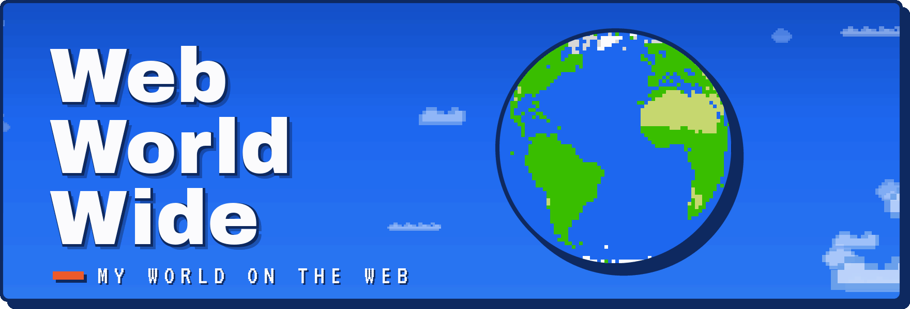
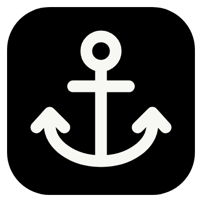
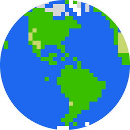

<!--
  Web World Wide: organization profile.
  GitHub renders this file (.github/profile/README.md) as the org landing page.

  - Art (banner.gif, eyebrow-*.png) is generated by ../tools/make-profile-art.py
    in the website's own visual language: sky, pixel clouds, the pixel-art
    Earth, Archivo Black + VT323, ink borders and hard shadows. Re-run it with
    `uv run tools/make-profile-art.py` after the site's look changes, and ship
    visual changes under a new filename (GitHub caches /raw/ images hard).
  - Web World Wide card icon is the site's favicon (site/public/favicon.png).
  - Project logos: 400x400 PNGs in ./assets, linked to each repo.
  - Each project card has the same shape: logo | title, blurb, platforms and
    stack as one quiet line, status badges. Titles are plain text (no emoji).
    Status badges (in order): stars · last commit · latest release · license · website.
-->

  <a href="https://webworldwide.online"><b>webworldwide.online</b></a>
  &nbsp;·&nbsp; <a href="https://webworldwide.online/blog/">Blog</a>
  &nbsp;·&nbsp; <a href="https://www.youtube.com/@web_world_wide">YouTube</a>
  &nbsp;·&nbsp; <a href="https://webworldwide.online/rss.xml">RSS</a>

 

<h2>
  <picture>
    <source media="(prefers-color-scheme: dark)" srcset="assets/eyebrow-projects-dark.png" />
    
  </picture>
</h2>

<!-- FileID -->
<table>
  <tr>
    <td width="150" align="center" valign="middle">
      
    </td>
    <td valign="middle">
      <h3><a href="https://github.com/WebWorldWide/FileID">FileID</a></h3>
      
On-device AI file organizer. Clusters faces, finds duplicates, captions images,
      suggests filenames, and restructures folders with a preview before anything moves.
      Fully local: no cloud, no telemetry. 
      macOS · Windows &nbsp;—&nbsp; Rust · Swift · .NET

      

        
        
        
        
        &nbsp;
      

    </td>
  </tr>
</table>

<!-- Document Finder -->
<table>
  <tr>
    <td width="150" align="center" valign="middle">
      
    </td>
    <td valign="middle">
      <h3><a href="https://github.com/WebWorldWide/Document-Finder">Document Finder</a></h3>
      
Open-access research finder. Searches 8 scholarly sources plus the web in parallel,
      extracts text into per-query SQLite libraries, and bundles each one into a
      <code>.zip</code> ready for an AI context window. Optional on-device AI. 
      macOS · Windows · Linux &nbsp;—&nbsp; Tauri · Rust · SolidJS · SQLite

      

        
        
        
        
        &nbsp;
      

    </td>
  </tr>
</table>

<!-- Media Shuttle -->
<table>
  <tr>
    <td width="150" align="center" valign="middle">
      
    </td>
    <td valign="middle">
      <h3><a href="https://github.com/WebWorldWide/media-shuttle">Media Shuttle</a></h3>
      
Verified camera-card ingest. Sorts photos and videos into a predictable folder layout,
      checks every copy with SHA-256, imports straight into Apple Photos, and keeps card erase
      locked until every file is confirmed safe. 
      macOS · Windows · Linux &nbsp;—&nbsp; Swift · .NET · Python · GTK

      

        
        
        
        
        &nbsp;
      

    </td>
  </tr>
</table>

<!-- Anchor -->
<table>
  <tr>
    <td width="150" align="center" valign="middle">
      
    </td>
    <td valign="middle">
      <h3><a href="https://github.com/WebWorldWide/Anchor">Anchor</a></h3>
      
Paused should mean paused. Holds your pause until <em>you</em> press play, so ads,
      reconnects and scripts can't restart a video behind your back, while autoplay, next
      episodes and media keys keep working. Works with any HTML player, including Jellyfin
      and Plex. No network requests, no telemetry. 
      Chrome · Brave · Edge · Vivaldi · Opera (desktop) &nbsp;—&nbsp; JavaScript · Manifest V3

      

        
        
        
        
      

    </td>
  </tr>
</table>

<!-- Watched Blocked -->
<table>
  <tr>
    <td width="150" align="center" valign="middle">
      
    </td>
    <td valign="middle">
      <h3><a href="https://github.com/WebWorldWide/watched-blocked">Watched Blocked</a></h3>
      
Hide videos you've already watched on YouTube. Clears them from the home page,
      sidebar, search and playlists, with a minimum-watched threshold, hide-or-dim mode
      and per-page toggles. Settings sync through your browser. 
      Chrome · Brave · Edge &nbsp;—&nbsp; JavaScript · Manifest V3

      

        
        
        
        
      

    </td>
  </tr>
</table>

<!-- Web World Wide -->
<table>
  <tr>
    <td width="150" align="center" valign="middle">
      
    </td>
    <td valign="middle">
      <h3><a href="https://github.com/WebWorldWide/webworldwide-website">Web World Wide</a></h3>
      
The home base. An independent, self-hosted blog and site built with Astro, featuring
      the hand-built pixel-art Earth spinning above. Apps, writing, videos, and links
      to everywhere else. 
      Web &nbsp;—&nbsp; Astro · TypeScript

      

        
        
        &nbsp;
      

    </td>
  </tr>
</table>

 

<h2>
  <picture>
    <source media="(prefers-color-scheme: dark)" srcset="assets/eyebrow-elsewhere-dark.png" />
    
  </picture>
</h2>

  <a href="https://www.youtube.com/@web_world_wide">YouTube</a>
  &nbsp;·&nbsp; <a href="https://x.com/mywebworldwide">X</a>
  &nbsp;·&nbsp; <a href="https://bsky.app/profile/web-world-wide.bsky.social">Bluesky</a>
  &nbsp;·&nbsp; <a href="https://mastodon.social/@webworldwide">Mastodon</a>
  &nbsp;·&nbsp; <a href="https://www.reddit.com/user/web_world_wide">Reddit</a>
  &nbsp;·&nbsp; <a href="https://www.instagram.com/mywebworldwide">Instagram</a>
  &nbsp;·&nbsp; <a href="https://www.threads.net/@mywebworldwide">Threads</a>

 

  <em>My World on the Web</em> &nbsp;·&nbsp; © Web World Wide &nbsp;·&nbsp; <a href="#top">back to top ↑</a>
   
  

